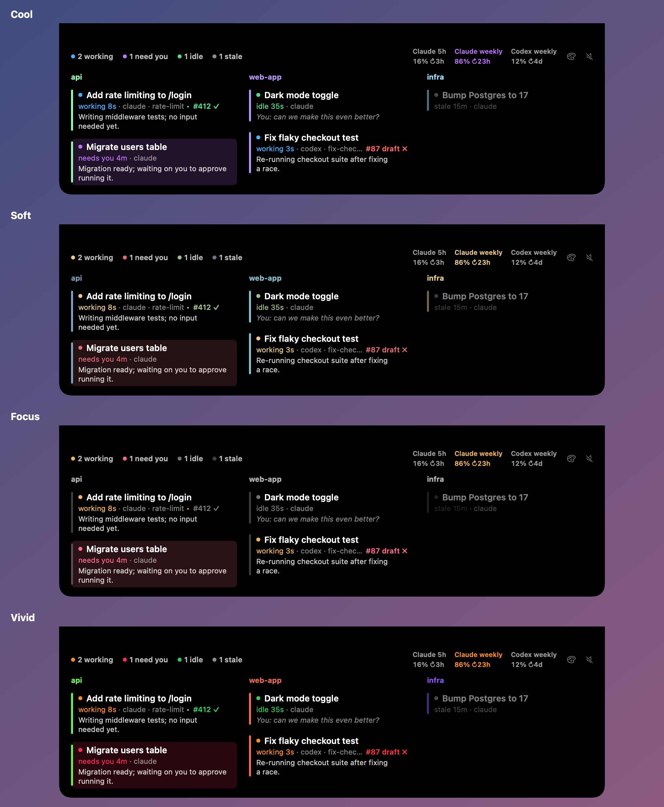

# cc-sessions-viewer

See every Claude Code and Codex session you have running, and jump to the one that needs you.

Hover the MacBook notch for the panel. Sessions are grouped by repo; click one to bring it forward in the app it runs in.


When a turn ends or a session starts needing you, you get a soft chime and a line under the notch:


The same list in the terminal:

```
$ ccs
api
  ● Migrate users table  claude · api · needs you 4m
      Migration ready; waiting on you to approve running it.
  ● Add rate limiting to /login  claude · api · rate-limit* · #412 ✓ · busy 8s
      Writing middleware tests; no input needed yet.
web-app
  ● Fix flaky checkout test  codex · web-app · busy 3s
      Re-running checkout suite after fixing a race.
```

## Features

| Feature | What it does |
|---|---|
| Notch panel | Hover the notch to see all sessions, grouped by repo. Up to three per repo, then the column scrolls |
| Session states | working, needs you, idle, stale (idle over a day). The Claude or Codex icon is tinted by state |
| Click to open | Exact tab in Ghostty and Terminal, the right window in VS Code, Cursor, Windsurf and VSCodium, the app itself otherwise |
| Summary card | Hover a session for 200 ms to read its full summary or last prompt |
| Toasts and chimes | One line under the notch per session; Tink for finished, Glass for needs you |
| Mute | Speaker icon in the panel header (remembered), or `--quiet` for one run |
| Shortcuts | control-option-S pins the panel open; Esc, a click outside it, or the shortcut again closes it. control-option-N jumps to the next session that needs you |
| Git and PR | Branch, a dot for uncommitted changes, PR number with CI result (click to open) |
| Usage limits | Claude and Codex usage below the sessions, fetched live when the panel opens; bars change color at 80% and 95% |
| Summaries | Optional one-line AI summary per session (Claude: Haiku, Codex: Luna) |
| Themes | Cool, Soft, Focus, Vivid (see below) |
| Terminal list | `ccs`, with `--watch` and `--json`; `ccs --limits` for usage, `--refresh` to fetch it live |
| Setup check | `ccs --doctor` says what is missing and how to fix it |
| Beside another notch app | `--beside-notch` shows a small pill right of the notch, for running next to apps like boringNotch |

"Needs you" means Claude Code reports a pending permission, input, sandbox, worker or goal request. Ordinary text questions, dialogs such as `/usage`, and AI summaries never trigger it.

## Themes

Click the palette icon in the panel header for the next theme, right-click to pick one. The choice is remembered. `--palette <id>` sets it for one run.

| Theme | Look |
|---|---|
| Cool (default) | Green to violet repos, blue and violet states, coral only for what is broken |
| Soft | Muted tones; amber, rose and sage for the states |
| Focus | White repos; color only where something needs a look |
| Vivid | Any hue per repo, traffic-light states |



## Install

**Packaged app.** Download the DMG from [GitHub Releases](https://github.com/Castruu/cc-sessions-viewer/releases) (Apple Silicon, macOS 14 or later), drag **CC Sessions Viewer** to **Applications**, open it and hover the notch. The CLI is inside the app at `Contents/MacOS/ccs`, the hooks at `Contents/Resources/hooks/`.

**From source.** Needs Rust (`cargo`) and the Xcode command line tools (`swiftc`).

```sh
./install.sh
```

This builds `build/ccs` and `build/notch`, links `ccs` into `~/.local/bin`, and starts the overlay now and at every login. Arguments go to the overlay, for example `./install.sh --beside-notch --quiet`. It ends with the optional hook snippets (your path filled in) and a setup check. To only build: `./build.sh`, then `build/notch &`.

The first click on a session asks for Automation permission to control your terminal. Allow it.

## Optional setup

**Summaries.** A Stop hook writes a one-line summary per session, at most once per 3 minutes per session. Needs `jq`. Without it the row shows your last prompt. For the packaged app, use `'/Applications/CC Sessions Viewer.app/Contents/Resources/hooks/summarize.sh'` as the command.

Claude Code, in `~/.claude/settings.json`:

```json
"hooks": {
  "Stop": [{ "hooks": [{ "type": "command", "command": "/ABSOLUTE/PATH/cc-sessions-viewer/hooks/summarize.sh" }] }]
}
```

Codex, in `~/.codex/hooks.json` (keep any existing hooks):

```json
{ "hooks": { "Stop": [{ "hooks": [{ "type": "command", "command": "/ABSOLUTE/PATH/cc-sessions-viewer/hooks/summarize.sh codex" }] }] } }
```

**Limits between panel opens.** Opening the panel already fetches current usage. To also update it as you use Claude Code, add this status line to `~/.claude/settings.json`. It prints a short line (model, usage, context).

```json
"statusLine": { "type": "command", "command": "/ABSOLUTE/PATH/cc-sessions-viewer/hooks/statusline.sh" }
```

**PR state and CI.** Needs the [GitHub CLI](https://cli.github.com) (`gh`), logged in. Looked up in the background at most once every 5 minutes, never for stale sessions. Codex sessions show the PR of the checked-out branch, except on `main` and `master`.

**Exact tab in Ghostty.** Needs [Ghostty](https://ghostty.org) 1.4+. To keep the list one keypress away, add `keybind = global:cmd+backquote=toggle_quick_terminal` to its config and run `ccs --watch` there.

## Privacy and network

Session data is read locally from the files Claude Code and Codex already write. Three things leave your machine, each with your existing logins:

- **Usage.** Opening the panel (or `ccs --limits --refresh`) asks Anthropic and OpenAI for your current limits. Five-second timeout, credentials stay in memory, logins are never renewed or rewritten. A failed fetch keeps the last values.
- **PR status.** Goes through `gh`. PR links must be HTTPS, match the shown PR number, and point at `github.com` or a host registered in `gh`; anything else shows as a number without a link.
- **Summaries.** Opt-in. Recent user and assistant text is sent through your installed Claude or Codex CLI, with tools, project settings and user hooks disabled. Organization-managed hooks may still apply.

Prompt excerpts and summaries are cached under `~/.cache/ccs`, readable only by your account. Files left by closed sessions are removed after a day.

## How it works

No daemon and no polling. `ccs` parses only what was appended to each transcript since the last run. The overlay refreshes on file events, at most once a second, and stops while the screen is locked or asleep.

## Development

```sh
cargo test
python3 tests/SummaryHookTests.py     # both summary hooks, without calling a model
swiftc -parse-as-library notch/EditorWindow.swift tests/EditorWindowTests.swift -o /tmp/t && /tmp/t
# overlay tests: NotificationSound, NotchLayout, UsageRefresh, Pin, SummaryPreview (opens temporary panels)
swiftc -parse-as-library -D NOTCH_TESTS notch/*.swift tests/NotchLayoutTests.swift -o /tmp/t && /tmp/t
build/notch --snapshot docs --palettes  # regenerate the screenshots from sample data
```

CI runs these on every pull request, except SummaryPreview. For release builds see [Packaging a release](docs/releasing.md).
