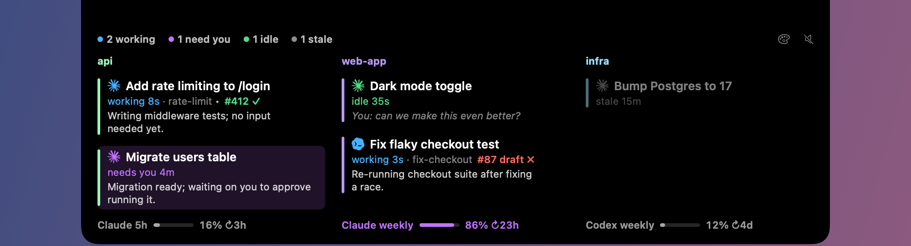

# cc-sessions-viewer

See your active Claude Code and Codex sessions at a glance.

Hover the MacBook notch to see every session, grouped by repo. Click one to bring it forward in the app it runs in.

Session data is read locally. Opening the notch checks usage with Anthropic and OpenAI, PR status uses GitHub, and optional AI summaries send recent conversation text through your installed Claude or Codex CLI. Prompt excerpts and summaries are cached under `~/.cache/ccs`, accessible only to your account.

Each session's Claude or Codex icon is tinted by its status, with the state written below it. Hover the icon to see the provider name.

Hover a session for 200 ms to read its full summary or last prompt in a floating card. Move onto the card to keep it open; long text scrolls inside it.



When a session finishes its turn you get a soft chime and this:


Or in the terminal:

```
$ ccs
api
  ● Migrate users table  claude · api · needs you 4m
      Migration ready; waiting on you to approve running it.
  ● Add rate limiting to /login  claude · api · rate-limit* · #412 ✓ · busy 8s
      Writing middleware tests; no input needed yet.
web-app
  ● Fix flaky checkout test  codex · web-app · busy 3s
      Re-running checkout suite after fixing a race.
```

- `ccs`: list sessions (`--watch` to refresh, `--json` for tools)
- `ccs --limits`: Claude 5h/weekly and Codex usage from local caches. Add `--refresh` to fetch current limits with your existing Claude Code and Codex logins. With the default Cool palette, a bar turns violet at 80% and coral at 95%.
- `notch`: macOS overlay; hover the notch to see sessions. Usage limits sit below the sessions with inline bars, percentages and reset times; narrow panels wrap them into rows; click the chart icon in the panel header to hide or show them (remembered). Palettes: Cool (default), Soft, Focus, Vivid. Click the palette icon in the panel header for the next one, right-click to pick; remembered. `--palette <id>` for one run.
- `hooks/summarize.sh`: Stop hook that writes a one-line AI summary per session (Claude: Haiku; Codex: Luna; at most once per 3 min per session)
- `hooks/statusline.sh`: optional Claude Code status line; keeps Claude limits fresh between `/usage` cache updates

Each session shows its state: working, idle, needs you (Claude Code explicitly reports a pending permission, input, sandbox, worker or goal request) or stale (idle for over a day). Informational dialogs such as `/usage`, ordinary text questions and AI summaries do not trigger "needs you". You also get the git branch, a dot for uncommitted changes, and the branch's pull request with its CI result (click it to open the PR). A turn that ends plays Tink; a session that starts needing you plays Glass. Click the speaker icon beside the palette icon to mute or unmute both chimes; the choice is remembered across launches, and visual notifications still appear.

Clicking a session opens it where it runs: the exact tab in Ghostty and Terminal, the right folder or multi-folder workspace window in VS Code, Cursor, Windsurf and VSCodium (an editor's terminal tab cannot be picked from outside), and the app itself for anything else.

The closed overlay refreshes when session files change or a session starts. With lifecycle hooks enabled, a normal exit clears its dot immediately. Opening the panel reconciles crashes and missed events, and the open panel refreshes every two seconds. Opening it also fetches current Claude and Codex limits in the background; cached values stay visible if a request fails. It stops while the screen is locked or asleep. Each repo shows up to three sessions before scrolling vertically within its own column; the repo heading stays visible, with a count when there are more sessions. With more repos than fit on screen, the panel scrolls sideways.

PR links must use HTTPS and match the displayed PR number. The viewer accepts `github.com` and exact hostnames registered in GitHub CLI’s `hosts.yml` (for example, after `gh auth login --hostname git.example.com`). An unrecognized link shows as a PR number without a link.

A Claude session's pull request comes from its own transcript, so the number and link need no network. Its state and CI result need the [GitHub CLI](https://cli.github.com) (`gh`), logged in: they are looked up in the background at most once every 5 minutes and skipped for stale sessions. Codex sessions, and Claude sessions with no recorded PR, show the PR of the branch that is checked out, except on `main` and `master`.

## Install on Mac

```sh
curl -fsSL https://raw.githubusercontent.com/Castruu/cc-sessions-viewer/main/install.sh | sh
```

This needs an Apple Silicon Mac on macOS 14 or later. It downloads the latest [release](https://github.com/Castruu/cc-sessions-viewer/releases), copies **CC Sessions Viewer** to **Applications**, replacing any earlier copy, and opens it. Hover over the notch. macOS may ask for Automation permission when you select a terminal session.

The app is not notarized by Apple. The installer avoids the Gatekeeper warning because `curl` downloads are not quarantined. If you download the DMG in a browser instead, macOS blocks the first launch; allow it under System Settings → Privacy & Security → Open Anyway.

The app has no Dock icon or menu. It starts at login after its first launch from Applications; turn that off in System Settings → General → Login Items. To quit it, use Activity Monitor or `killall notch`.

The installed app includes the CLI at `/Applications/CC Sessions Viewer.app/Contents/MacOS/ccs`. Summaries are opt-in. To use the packaged Claude summary hook, use this JSON field in the Stop hook configuration below (for Codex, append ` codex` after the closing single quote):

```json
"command": "'/Applications/CC Sessions Viewer.app/Contents/Resources/hooks/summarize.sh'"
```

The status-line hook is in the same folder. For release builds, see [Packaging a release](docs/releasing.md).

## Requirements

- macOS, Rust (`cargo`) and Xcode command line tools (`swiftc`) to build
- `jq` for the summary hook
- [Ghostty](https://ghostty.org) 1.4+ only for jumping to the exact tab of a Ghostty, tmux or Codex session; everything else works without it

## Build

```sh
./build.sh          # -> build/ccs, build/notch
build/notch &       # start the overlay
```

To check editor window matching:

```sh
swiftc -parse-as-library notch/EditorWindow.swift tests/EditorWindowTests.swift -o /tmp/ccs-editor-tests
/tmp/ccs-editor-tests
```

To check notification sounds and muting without playing audio:

```sh
swiftc -parse-as-library -D NOTCH_TESTS notch/*.swift tests/NotificationSoundTests.swift -o /tmp/ccs-notification-tests
/tmp/ccs-notification-tests
```

To check that usage data does not widen the session panel:

```sh
swiftc -parse-as-library -D NOTCH_TESTS notch/*.swift tests/NotchLayoutTests.swift -o /tmp/ccs-layout-tests
/tmp/ccs-layout-tests
```

To check live usage refreshes only happen when opening the panel:

```sh
swiftc -parse-as-library -D NOTCH_TESTS notch/*.swift tests/UsageRefreshTests.swift -o /tmp/ccs-usage-tests
/tmp/ccs-usage-tests
```

To check summary cards, including hover delays, scrolling and screen-edge placement (opens temporary test panels):

```sh
swiftc -parse-as-library -D NOTCH_TESTS notch/*.swift tests/SummaryPreviewTests.swift -o /tmp/ccs-summary-preview-tests
/tmp/ccs-summary-preview-tests
```

## Other Claude and Codex directories

Sessions started with `CLAUDE_CONFIG_DIR` keep their registry outside `~/.claude`. List those directories in `~/.config/ccs/claude-dirs`, one per line (`~/` is expanded); `~/.claude` is always scanned. Do the same for `CODEX_HOME` directories in `~/.config/ccs/codex-dirs`; `~/.codex` is always scanned. Restart the notch after editing the list. Hooks go in each directory's own `settings.json` (Claude) or `hooks.json` (Codex).

Each directory is a profile, named after its folder (`default` for `~/.claude` and `~/.codex`); a Claude and a Codex directory with the same folder name are one profile. When sessions run under more than one, the open panel shows a chip per profile above the counts; click one to list only its sessions, or `all`. The pick is remembered. The usage footer shows the picked profile's limits, or every profile's while `all` is picked, with the profile named (`Claude work 5h`). The closed notch, the finished banner and the chimes still cover every profile. `ccs --json` reports each session's `profile`.

```
~/.claude-work
```

## Session start and end hooks

Merge these entries into the existing `hooks` object in `~/.codex/hooks.json` to update the notch on a normal exit or resume. Keep any handlers already registered for those events.

```json
{
  "SessionStart": [{ "hooks": [{ "type": "command", "command": "'/Applications/CC Sessions Viewer.app/Contents/MacOS/notch' --session-hook codex" }] }],
  "SessionEnd":   [{ "hooks": [{ "type": "command", "command": "'/Applications/CC Sessions Viewer.app/Contents/MacOS/notch' --session-hook codex" }] }]
}
```

For Claude Code, use the same entries in `~/.claude/settings.json` with `--session-hook claude`. For a source build, use the absolute path to `build/notch`. Review the new commands in Codex with `/hooks`.

The hooks send the provider and session ID to the running overlay on this Mac. Hovers still refresh the session list if a hook is missing or a process is force-quit.

## Enable summaries

Add to `~/.claude/settings.json`:

```json
"hooks": {
  "Stop": [{ "hooks": [{ "type": "command", "command": "/ABSOLUTE/PATH/cc-sessions-viewer/hooks/summarize.sh" }] }]
}
```

Without it, the last prompt is shown instead. Summaries are for display only; "needs you" always comes from explicit pending requests.

For Codex, add a Stop hook to `~/.codex/hooks.json` (keep any existing hooks):

```json
{
  "hooks": {
    "Stop": [{ "hooks": [{ "type": "command", "command": "/ABSOLUTE/PATH/cc-sessions-viewer/hooks/summarize.sh codex" }] }]
  }
}
```

Codex summaries use `codex exec --model gpt-6-luna` with your existing Codex login. The hook summarizes recent user and assistant text, skips tools and injected instructions, and runs in the background. Luna runs read-only with coding instructions, shell tools, plugins and hooks disabled, without persisting a session. Failed or empty responses keep the previous summary. Claude summaries run Haiku through your installed CLI from the cache directory, with project settings and user-configured hooks disabled. Organization-managed hooks may still apply.

Check both summary hooks without calling a model with `python3 tests/SummaryHookTests.py`.

## Keeping limits current

Opening the notch fetches current Claude and Codex usage concurrently. Claude uses its existing login from macOS Keychain or `~/.claude/.credentials.json`; Codex uses the ChatGPT login in `~/.codex/auth.json` (or `$CODEX_HOME/auth.json`), and `auth.json` in each listed Codex directory. Each profile is fetched with its own login: `.credentials.json` in its config directory, or the Keychain item Claude Code created for that directory (list the directory spelled as in `CLAUDE_CONFIG_DIR`; macOS asks once per login). API-key logins have no subscription quota to fetch. Each request has a five-second timeout and keeps credentials in memory. Existing logins are never renewed or rewritten.

`ccs --limits --refresh` does the same in the terminal. Ordinary refreshes only read local caches; newer Codex session usage events override older API samples, and reset windows remain visible at 0%. A failed fetch keeps the last available values for that provider.

The status-line hook is optional. To also update the cache as you use Claude Code, add to `~/.claude/settings.json`:

```json
"statusLine": { "type": "command", "command": "/ABSOLUTE/PATH/cc-sessions-viewer/hooks/statusline.sh" }
```

It prints a short line (model, usage, context) and saves the limits to `~/.cache/ccs/claude-limits.json` (`claude-limits-<folder>.json` for another config directory). `ccs --limits` uses the newest sample for each window.

## Running next to another notch app

`build/notch --beside-notch` puts the overlay in a small pill to the right of the notch instead of on it, one window level lower, so it does not fight apps like boringNotch for the hover area.

## Ghostty quick terminal

```
keybind = global:cmd+backquote=toggle_quick_terminal
```

then run `build/ccs --watch` in it.

## Screenshots

Regenerate them from sample data with `build/notch --snapshot docs`. Add `--palettes` to also render every palette on one sheet (`palettes.png`).
